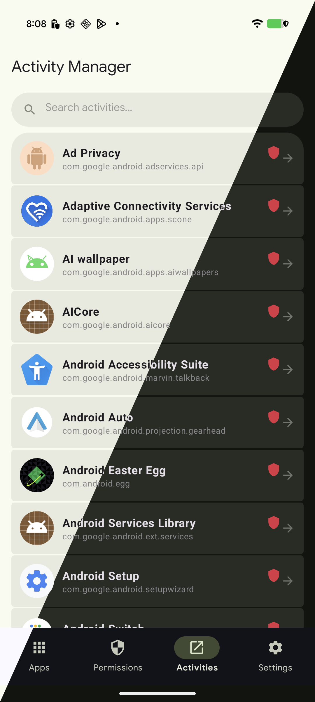

# Buge App Manager

  <picture>
    <source media="(prefers-color-scheme: dark)" srcset="../../assets/readme/dark/icon.svg"/>
    
  </picture>

  <picture>
    <source media="(prefers-color-scheme: dark)" srcset="../../assets/readme/dark/title.svg"/>
    
  </picture>

  
  
  
  

🌐 [اقرأ بلغة أخرى](../README.md)

**Buge App Manager** تطبيق أدوات قوي لنظام Android، مصمم لإدارة التطبيقات والأذونات بشكل متقدم. بُني باستخدام **Material Design 3 Expressive**، ويوفر واجهة حديثة وبديهية تمنحك تحكمًا دقيقًا في جهازك.

---

## لقطات الشاشة

## الميزات

### القدرات الأساسية

| الميزة                                | الوصف                                                                    |
| ------------------------------------- | ------------------------------------------------------------------------ |
| **التكامل مع Shizuku**                | يعمل بتفويض Shizuku للتحكم المتقدم دون الحاجة إلى Root                    |
| **التكامل مع Dhizuku**                | يعمل بتفويض مدير الجهاز في Dhizuku للتحكم المتقدم دون الحاجة إلى Root     |
| **التكامل مع ROOT**                   | يعمل بتفويض ROOT للتحكم المتقدم                                           |
| **إدارة التطبيقات**                   | تصفّح وأدر تطبيقات المستخدم وتطبيقات النظام بسهولة                        |
| **واجهة Material Design 3 Expressive** | واجهة نظيفة تتبع سمة النظام وتلتزم بأحدث إرشادات تصميم Android            |

### مدير التطبيقات

- إدارة أي تطبيق، **بما في ذلك تطبيقات النظام**

- دعم عمليات متقدمة مثل **إلغاء التثبيت** و**التعطيل** و**الإيقاف القسري** وغيرها

- إمكانية **استعادة تطبيقات النظام التي أُلغيت**

### مدير الأذونات

- عرض أذونات التطبيقات وتعديلها حسب **الفئة**
- الفئات المدعومة: الميكروفون، الكاميرا، الوصول إلى الموقع، الإشعارات، الهاتف وجهات الاتصال، التخزين وغيرها
- تصفية الأذونات حسب حالة **ممنوح** أو **مرفوض**
- عمليات أذونات جماعية لعدة تطبيقات

### مشغّل الأنشطة

- تصفّح و**شغّل** أي نشاط
- عرض الأنشطة غير المصدَّرة

### الخصوصية والأمان

- تحديد التطبيقات التي تملك أذونات حساسة بسرعة
- تحسين أمان جهازك من خلال رؤية واضحة للأذونات

---

## المتطلبات

| المتطلب | الحد الأدنى من الإصدار              |
| ------- | ----------------------------------- |
| Android | 8.0 (API 26) أو أحدث                |
| Shizuku | مثبَّت ومفوَّض                        |
| Dhizuku | مثبَّت ومفوَّض                        |
| ROOT    | الجهاز مُروَّت ومفوَّض                |

اختر أحد أنواع التفويض: **Shizuku** أو **Dhizuku** أو **ROOT**.

> **ملاحظة**: تتطلب ميزات إدارة الأذونات المتقدمة وجود [Shizuku](https://shizuku.rikka.app/) أو [Dhizuku](https://github.com/iamr0s/Dhizuku).

---

## اللغات المدعومة

- English - en

- Français - fr

- Deutsch - de

- Русский - ru

- Українська - uk

- Türkçe - tr

- Português - pt

- Português (Brasil) - pt-rBR

- Español - es

- 中文 (简体) - zh

- 中文 (繁体) - zh-rTW

- العربية - ar

- 日本語 - ja

- 한국어 - ko

[إذا كنت ترغب في طلب دعم لغة معينة، افتح issue وأخبرنا بذلك](https://github.com/BugeStudioTeam/Buge-App-Manager/issues)

---

## التثبيت

  

---

## سجل النجوم

<a href="https://www.star-history.com/?repos=BugeStudioTeam%2FBuge-App-Manager&type=date&legend=top-left">
 <picture>
   <source media="(prefers-color-scheme: dark)" srcset="https://api.star-history.com/chart?repos=BugeStudioTeam/Buge-App-Manager&type=date&theme=dark&legend=top-left&sealed_token=jZTygO4Pz6rzviCijN8nJplRBnY9ehHv9qlEL3uW_EVikw63qBIraoS0O7xV3lszffGX8ONjKeKo47xT3Kv8g6xwd27TbnZVekUxbRDLPGZjUlV7vc-jPg" />
   <source media="(prefers-color-scheme: light)" srcset="https://api.star-history.com/chart?repos=BugeStudioTeam/Buge-App-Manager&type=date&legend=top-left&sealed_token=jZTygO4Pz6rzviCijN8nJplRBnY9ehHv9qlEL3uW_EVikw63qBIraoS0O7xV3lszffGX8ONjKeKo47xT3Kv8g6xwd27TbnZVekUxbRDLPGZjUlV7vc-jPg" />
   
 </picture>
</a>

---

## الدعم

إذا وجدت Buge App Manager مفيدًا، ففكّر في دعم المشروع. 
دعمك يساعد في استمرار التطوير!

**[ادعمنا](https://bugestudio.website/support/)**

---

## الترخيص

هذا المشروع مرخَّص بموجب **GNU General Public License v3.0**.
