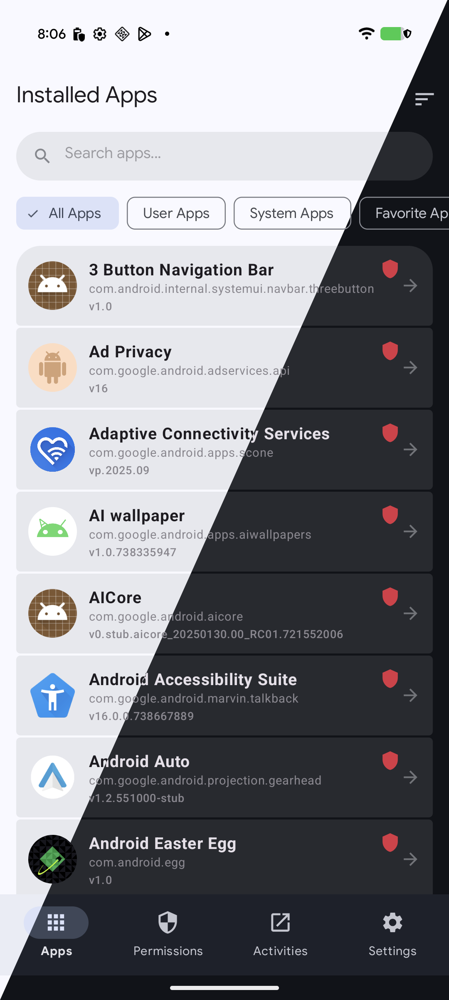
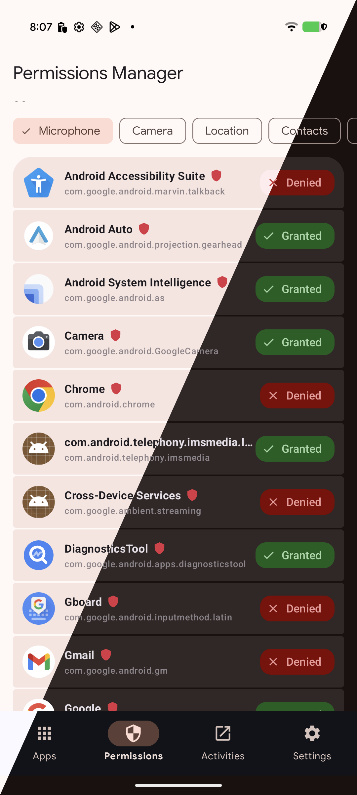
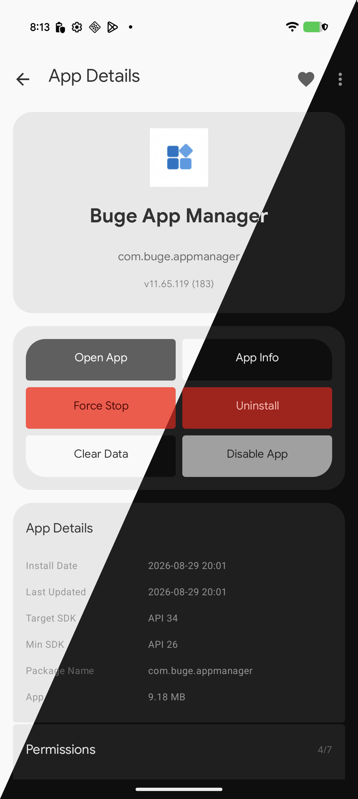

# Buge App Manager

  <picture>
    <source media="(prefers-color-scheme: dark)" srcset="../../assets/readme/dark/icon.svg"/>
    
  </picture>

  <picture>
    <source media="(prefers-color-scheme: dark)" srcset="../../assets/readme/dark/title.svg"/>
    
  </picture>

  
  
  
  

🌐 [Read this in another language](../README.md)

**Buge App Manager** is a powerful Android utility application designed for advanced app and permission management. Built with **Material Design 3 Expressive**, it offers a modern and intuitive interface for granular control over your device.

---

## Screenshots

## Features

### Core Capabilities

| Feature                             | Description                                                                      |
| ----------------------------------- | -------------------------------------------------------------------------------- |
| **Shizuku Integration**             | Operates with Shizuku authorization for elevated control without requiring root  |
| **Dhizuku Integration**             | Operates with Dhizuku Device Admin authorization for elevated control without requiring root  |
| **ROOT Integration**                | Operates with ROOT authorization for elevated control                            |
| **App Management**                  | Browse and manage both user-installed and system applications with ease          |
| **Material Design 3 Expressive UI** | Clean, system-themed interface that follows the latest Android design guidelines |

### Apps Manager

- Manage any apps, **including system apps**

- Allow advanced operations such as **Uninstall**, **Disable**, **Force Stop**, etc.

- Allow **restoring uninstalled system apps**

### Permission Manager

- View and modify app permissions by **category**
- Supported categories include: Microphone, Camera, Location access, Notifications, Phone & Contacts, Storage and other
- Filter permissions by **granted** or **denied** status
- Batch permission operations for multiple apps

### Activities Launcher

- Browse and **launch** any activity
- View unexported activities

### Privacy & Security

- Quickly identify which apps have access to sensitive permissions
- Optimize your device's security posture with clear permission insights

---

## Requirements

| Requirement | Minimum Version                       |
| ----------- | ------------------------------------- |
| Android OS  | 8.0 (API 26) or higher                |
| Shizuku     | Installed and authorized              |
| Dhizuku     | Installed and authorized              |
| ROOT        | Device has been rooted and authorized |

Choose between **Shizuku**, **Dhizuku** or **ROOT** authorization.

> **Note**: [Shizuku](https://shizuku.rikka.app/) or [Dhizuku](https://github.com/iamr0s/Dhizuku) is required for advanced permission management features.

---

## Supported languages

- English - en

- Français - fr

- Deutsch - de

- Русский - ru

- Українська - uk

- Türkçe - tr

- Português - pt

- Português (Brasil) - pt-rBR

- Español - es

- 中文 (简体) - zh

- 中文 (繁体) - zh-rTW

- العربية - ar

- 日本語 - ja

- 한국어 - ko

[If you'd like to request support for a specific language, please open an issue and let us know](https://github.com/BugeStudioTeam/Buge-App-Manager/issues)

---

## Installation

  

---

## Star History

<a href="https://www.star-history.com/?repos=BugeStudioTeam%2FBuge-App-Manager&type=date&legend=top-left">
 <picture>
   <source media="(prefers-color-scheme: dark)" srcset="https://api.star-history.com/chart?repos=BugeStudioTeam/Buge-App-Manager&type=date&theme=dark&legend=top-left&sealed_token=jZTygO4Pz6rzviCijN8nJplRBnY9ehHv9qlEL3uW_EVikw63qBIraoS0O7xV3lszffGX8ONjKeKo47xT3Kv8g6xwd27TbnZVekUxbRDLPGZjUlV7vc-jPg" />
   <source media="(prefers-color-scheme: light)" srcset="https://api.star-history.com/chart?repos=BugeStudioTeam/Buge-App-Manager&type=date&legend=top-left&sealed_token=jZTygO4Pz6rzviCijN8nJplRBnY9ehHv9qlEL3uW_EVikw63qBIraoS0O7xV3lszffGX8ONjKeKo47xT3Kv8g6xwd27TbnZVekUxbRDLPGZjUlV7vc-jPg" />
   
 </picture>
</a>

---

## Support

If you find Buge App Manager useful, consider supporting the project. 
Your support helps keep development going!

**[Support Us](https://bugestudio.website/support/)**

---

## License

This project is licensed under the **GNU General Public License v3.0**.
