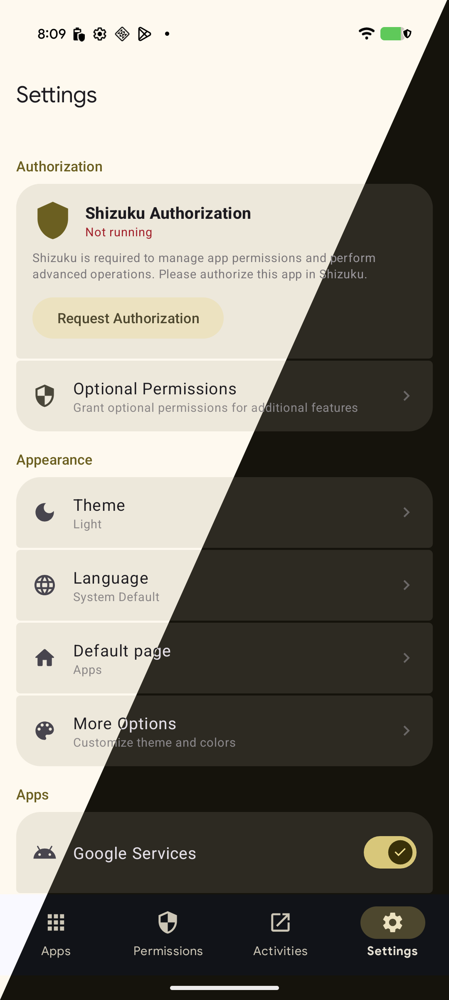

# Buge App Manager

  <picture>
    <source media="(prefers-color-scheme: dark)" srcset="../../assets/readme/dark/icon.svg"/>
    
  </picture>

  <picture>
    <source media="(prefers-color-scheme: dark)" srcset="../../assets/readme/dark/title.svg"/>
    
  </picture>

  
  
  
  

🌐 [Читати іншою мовою](../README.md)

**Buge App Manager** — потужна утиліта для Android, створена для поглибленого керування застосунками та дозволами. Побудована на **Material Design 3 Expressive** і пропонує сучасний та інтуїтивний інтерфейс для точного контролю над пристроєм.

---

## Скриншоти

## Можливості

### Основні можливості

| Можливість                            | Опис                                                                     |
| ------------------------------------- | ------------------------------------------------------------------------ |
| **Інтеграція з Shizuku**              | Працює з авторизацією Shizuku для розширеного контролю без root           |
| **Інтеграція з Dhizuku**              | Працює з авторизацією адміністратора пристрою Dhizuku без root            |
| **Інтеграція з ROOT**                 | Працює з авторизацією ROOT для розширеного контролю                        |
| **Керування застосунками**            | Зручний перегляд і керування користувацькими та системними застосунками    |
| **Інтерфейс Material Design 3 Expressive** | Чистий інтерфейс у системній темі згідно з актуальними рекомендаціями Android |

### Менеджер застосунків

- Керування будь-якими застосунками, **включно із системними**

- Підтримка розширених дій: **видалення**, **вимкнення**, **примусова зупинка** тощо

- **Відновлення видалених системних застосунків**

### Менеджер дозволів

- Перегляд і зміна дозволів застосунків за **категоріями**
- Підтримувані категорії: мікрофон, камера, доступ до місцеположення, сповіщення, телефон і контакти, сховище та інші
- Фільтрування дозволів за станом **надано** або **відхилено**
- Пакетні операції з дозволами для кількох застосунків

### Запуск Activity

- Перегляд і **запуск** будь-якої Activity
- Перегляд неекспортованих Activity

### Конфіденційність і безпека

- Швидке визначення застосунків із доступом до чутливих дозволів
- Оптимізація безпеки пристрою завдяки наочній інформації про дозволи

---

## Вимоги

| Вимога   | Мінімальна версія                      |
| -------- | -------------------------------------- |
| Android  | 8.0 (API 26) або новіша                |
| Shizuku  | Встановлено та авторизовано            |
| Dhizuku  | Встановлено та авторизовано            |
| ROOT     | Пристрій рутовано та авторизовано      |

Виберіть один із варіантів авторизації: **Shizuku**, **Dhizuku** або **ROOT**.

> **Примітка**: для розширеного керування дозволами потрібен [Shizuku](https://shizuku.rikka.app/) або [Dhizuku](https://github.com/iamr0s/Dhizuku).

---

## Підтримувані мови

- English - en

- Français - fr

- Deutsch - de

- Русский - ru

- Українська - uk

- Türkçe - tr

- Português - pt

- Português (Brasil) - pt-rBR

- Español - es

- 中文 (简体) - zh

- 中文 (繁体) - zh-rTW

- العربية - ar

- 日本語 - ja

- 한국어 - ko

[Якщо ви хочете запросити підтримку певної мови, створіть issue і повідомте нам](https://github.com/BugeStudioTeam/Buge-App-Manager/issues)

---

## Встановлення

  

---

## Історія зірок

<a href="https://www.star-history.com/?repos=BugeStudioTeam%2FBuge-App-Manager&type=date&legend=top-left">
 <picture>
   <source media="(prefers-color-scheme: dark)" srcset="https://api.star-history.com/chart?repos=BugeStudioTeam/Buge-App-Manager&type=date&theme=dark&legend=top-left&sealed_token=jZTygO4Pz6rzviCijN8nJplRBnY9ehHv9qlEL3uW_EVikw63qBIraoS0O7xV3lszffGX8ONjKeKo47xT3Kv8g6xwd27TbnZVekUxbRDLPGZjUlV7vc-jPg" />
   <source media="(prefers-color-scheme: light)" srcset="https://api.star-history.com/chart?repos=BugeStudioTeam/Buge-App-Manager&type=date&legend=top-left&sealed_token=jZTygO4Pz6rzviCijN8nJplRBnY9ehHv9qlEL3uW_EVikw63qBIraoS0O7xV3lszffGX8ONjKeKo47xT3Kv8g6xwd27TbnZVekUxbRDLPGZjUlV7vc-jPg" />
   
 </picture>
</a>

---

## Підтримка

Якщо Buge App Manager став вам у пригоді, підтримайте проєкт. 
Ваша підтримка допомагає розвитку!

**[Підтримати нас](https://bugestudio.website/support/)**

---

## Ліцензія

Проєкт розповсюджується за ліцензією **GNU General Public License v3.0**.
